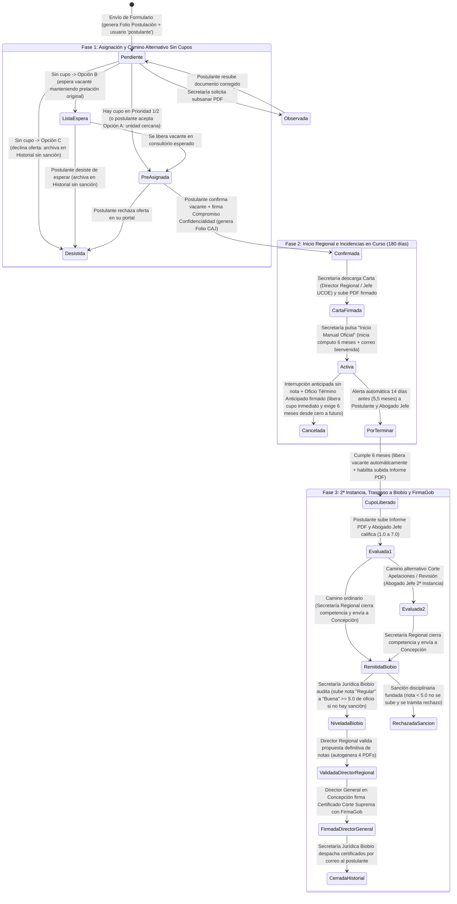
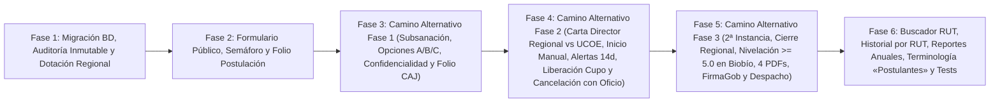

# Plan Maestro de Integración Técnica — Plataforma CAJ Biobío (`CajBioBioPlataforma`)

**Fecha:** 1 de noviembre de 2026  
**Proyecto objetivo:** `CajBioBioPlataforma` *(PHP 8.2+ / Laravel 12 / Blade / MySQL 8)*  
**Documento base:** `AUDITORIA_AVANCE_PROYECTO.md`

---

## Arquitectura Global de Cambios y Máquina de Estados Propuesta

El diseño integra el checklist de 8 secciones junto con las **tres fases operativas del Camino Alternativo para Regiones Externas**, apoyándose en **cuatro decisiones arquitectónicas centrales**:

1. **Segregación Territorial y Traspaso de Competencias (Regiones Externas vs. Sede Central Biobío):**
   - **Regiones Externas (`NB`, `AR`, `LR`, `LL`, `AI`):** Operadas por 1 funcionaria de Secretaría Regional por jurisdicción y 1 Director Regional. Emiten su Carta de Presentación a nombre del **Director Regional** respectivo, gestionan la práctica activa y las interrupciones anticipadas, y concluyen su competencia tras la 1ª (y eventual 2ª) calificación al remitir el expediente a Concepción.
   - **Sede Central Biobío (`BI` - Concepción):** Cuenta con 2 funcionarias de Secretaría Regional, el **Jefe de UCOE** (a cuyo nombre se emite la Carta de Presentación en Biobío), la **Secretaría Jurídica de Biobío (Concepción)** (que recepciona los expedientes cerrados de todas las regiones, nivela de oficio las notas *"Regulares"* $4.0 - 4.9$ a *"Buena"* $5.0$ si no hay sanción grave, y despacha los certificados finales) y el **Director General de la Corporación** (quien firma exclusivamente con **FirmaGob** el Certificado oficial para la Corte Suprema).
2. **Evolución no destructiva del esquema MySQL:** Una migración incremental (`2026_11_01_000001_integracion_checklist_y_regiones_externas.php`) incorpora los nuevos estados, folios, campos de auditoría, emisor regional y trazabilidad de nivelación de notas sin romper datos existentes.
3. **Estandarización transversal del término «postulantes» y rol unificado `'postulante'`:** En toda la interfaz, correos y PDFs se utiliza «postulante(s)», mientras que la cuenta de usuario se crea desde el envío del formulario inicial con rol `'postulante'` para que pueda subsanar documentos y confirmar su vacante pre-asignada.
4. **Máquina de estados formal en 3 Fases (Postulación $\rightarrow$ Desarrollo/Incidencias $\rightarrow$ Doble Instancia, Nivelación en Biobío y Cierre):**



---

## Plan Detallado por Punto del Checklist y Fases Regionales

---

### Sección 1: Acceso, Autenticación y Perfiles de Usuario

#### 1.1 Estandarización de terminología («postulantes» vs «practicantes») y correo `postulantes@cajbiobio.cl`
- **Estado actual:** `[~]` Correo configurado en `CajBioBioPlataforma/config/mail.php#L27`, pero la interfaz mantiene el término «practicante(s)».
- **Decisión de diseño:**
  - Reemplazar en todas las vistas Blade, componentes, menús, títulos, correos y plantillas PDF el término *"practicante(s)"* por **"postulante(s)"**.
  - Definir `'correo_contacto' => env('CAJ_CORREO_CONTACTO', 'postulantes@cajbiobio.cl')` en `CajBioBioPlataforma/config/caj.php`.
- **Archivos a intervenir:**
  - `CajBioBioPlataforma/resources/views/layouts/publico.blade.php`
  - `CajBioBioPlataforma/resources/views/layouts/portal.blade.php`
  - Vistas en `CajBioBioPlataforma/resources/views/{admin,gobernador,secretaria,tutor,practicante,postulante,postulacion,pdf}/`.

#### 1.2 Autenticación híbrida (RUT y clave asignada + espacio reservado ClaveÚnica)
- **Estado actual:** `[x]` Integrado en `CajBioBioPlataforma/app/Http/Controllers/Auth/LoginController.php` y `CajBioBioPlataforma/app/Http/Controllers/Auth/ClaveUnicaController.php`.
- **Decisión de diseño:**
  - **Creación inmediata de cuenta `'postulante'` al enviar el formulario:** En `CajBioBioPlataforma/app/Http/Controllers/Postulacion/PostulacionController.php#L129-L168`, crear o actualizar el registro en `usuarios` con `rol = 'postulante'` y clave temporal asignada desde el momento en que envía su postulación. Así el postulante puede iniciar sesión con su RUT para revisar el estado de su postulación, subsanar archivos observados y confirmar la vacante en estado `PreAsignada` (Opción A de Fase 1).

#### 1.3 Perfil Postulante (Acceso Simplificado)
- **Estado actual:** `[~]` Sin causas judiciales (cumple SAJ), pero sin módulo para aceptar/rechazar vacante pre-asignada ni subsanar documentos.
- **Decisión de diseño:**
  - Unificar la experiencia del rol `'postulante'` en `CajBioBioPlataforma/app/Http/Controllers/Postulante/PerfilController.php` y `CajBioBioPlataforma/app/Http/Controllers/Practicante/PracticanteController.php` para que muestre dinámicamente según el estado:
    1. **Fase de Postulación (`Pendiente`, `Observada`, `ListaEspera`):** Folio de postulación, estado de prelación y casilla de resubida de PDFs observados.
    2. **Fase de Confirmación (`PreAsignada`):** Tarjeta con el consultorio pre-asignado (sea por prioridad 1/2 o por reasignación asistida de Opción A), lectura y checkbox obligatorio del **Compromiso de Confidencialidad y Secreto Profesional**, botón **«Confirmar vacante y suscribir Compromiso»** (pasa a `Confirmada`) y botón **«Declinar oferta»** (pasa a `Desistida` sin sanción).
    3. **Fase de Práctica y Cierre (`Confirmada`, `Activa`, `CupoLiberado`, `CerradaHistorial`):** Progreso de los 180 días, casilla para subir el Informe Final en PDF (habilitada al cumplir los 6 meses) y descarga de la Resolución de término y del Certificado para la Corte Suprema firmado con FirmaGob.

#### 1.4 Perfil Secretaría Regional (Dotación regional: 1 en regiones externas y 2 en Biobío)
- **Estado actual:** `[x]` Filtro territorial integrado en `CajBioBioPlataforma/app/Support/Scope.php#L14-L24`.
- **Decisión de diseño:**
  - Actualizar `CajBioBioPlataforma/database/seeders/UsuariosDemoSeeder.php` para reflejar exactamente la estructura operativa institucional: **2 secretarias en la Región del Biobío (`BI`)** y **1 secretaria regional en cada una de las 5 regiones externas (`NB` Ñuble, `AR` La Araucanía, `LR` Los Ríos, `LL` Los Lagos, `AI` Aysén)**.
  - En las regiones externas, una vez que la práctica es calificada en 1ª instancia (y 2ª instancia si aplica), la Secretaría Regional tendrá el botón **«Cerrar Competencia Regional y Remitir a Jurídica Biobío»** (Fase 3.3), tras lo cual el expediente pasa a estado `RemitidaBiobio` y queda en modo solo lectura para la región de origen.

#### 1.5 Perfil Secretaría Biobío (Jurídica Central — Concepción)
- **Estado actual:** `[ ]` No integrado.
- **Decisión de diseño:**
  - Incorporar el rol `'juridica_central'` (y habilitar el permiso para la Secretaría Jurídica de Biobío en Concepción) con su propio controlador `CajBioBioPlataforma/app/Http/Controllers/Secretaria/JuridicaBiobioController.php` y rutas en `CajBioBioPlataforma/routes/portales/secretaria.php`.
  - **Atribuciones exclusivas en plataforma (Fase 3.3, 3.4 y 3.5):**
    1. **Recepción nacional:** Bandeja centralizada con todos los expedientes en estado `RemitidaBiobio` provenientes de las regiones externas y del propio Biobío.
    2. **Nivelación de notas de oficio (Regla $\ge 5.0$ "Buena"):** Si una región externa remitió una calificación *"Regular"* ($4.0$ a $4.9$) sin causales disciplinarias graves, habilitar el botón **«Subir nota de oficio a Buena (5.0)»** registrando la justificación normativa en auditoría y pasando a `NiveladaBiobio`. Si existen antecedentes sancionatorios fundados, habilitar el botón **«Rechazar por causal disciplinaria fundada»** (`RechazadaSancion`).
    3. **Despacho final y archivo (`CerradaHistorial`):** Una vez firmado el Certificado de la Corte Suprema por el Director General con FirmaGob, la Secretaría Jurídica de Biobío pulsa **«Despachar Certificados por Correo y Cerrar Expediente»**, enviando el correo formal al postulante y transfiriendo el registro a `CerradaHistorial`.

#### 1.6 Perfil Abogado Jefe / Consultorio Jurídico y Abogado Jefe de Segunda Instancia (Corte de Apelaciones)
- **Estado actual:** `[~]` Existe el rol `abogado` para 1ª instancia en `CajBioBioPlataforma/app/Http/Controllers/Tutor/TutorController.php`, pero no la distinción para el **Abogado Jefe de Segunda Instancia**.
- **Decisión de diseño:**
  - En la tabla `abogados` (`CajBioBioPlataforma/database/migrations/2026_10_05_000002_crea_usuarios.php#L50-L56`), añadir el booleano `es_segunda_instancia` (`default(false)`) y `region_id` (`nullable()`, para identificar al homólogo territorial de don Samuel Osorio en cada Corte de Apelaciones regional).
  - En `CajBioBioPlataforma/app/Http/Controllers/Tutor/TutorController.php`, cuando el abogado autenticado tiene `es_segunda_instancia = true`, mostrarle la bandeja **"Evaluaciones de Segunda Instancia (Corte de Apelaciones)"** para calificar y observar los expedientes derivados al camino alternativo de 2ª instancia (Fase 3.2).

#### 1.7 Perfil Director Regional vs. Director General de la Corporación
- **Estado actual:** `[~]` Existe un único rol `gobernador` sin separación entre Director Regional y Director General.
- **Decisión de diseño:**
  - Distinguir mediante el campo `region_id` del usuario con rol `'gobernador'` (o alias `'director'`):
    - **Director Regional (`region_id != null`):** Visualiza y aprueba (individualmente o por lotes) la propuesta definitiva de notas de los expedientes de su región (`NiveladaBiobio` $\rightarrow$ `ValidadaDirectorRegional`), gatillando la autogeneración de los **4 documentos oficiales en PDF**. Además, su nombre y cargo (*"Director Regional — Región de ..."*) encabeza las Cartas de Presentación de su región externa (Fase 2).
    - **Director General de la Corporación (`region_id == null`, sede Concepción):** Recibe los expedientes validados de todas las regiones (`ValidadaDirectorRegional`), descarga los documentos oficiales y sube el **Certificado de Aprobación para la Corte Suprema** firmado digitalmente mediante **FirmaGob** (`FirmadaDirectorGeneral`, Fase 3.5).

#### 1.8 Perfil Administrador General ("Modo Dios")
- **Estado actual:** `[x]` Integrado en `CajBioBioPlataforma/app/Http/Controllers/Admin/`.
- **Decisión de diseño:** Mantener todas sus facultades nacionales y añadir el visor del Log Inmutable de Auditoría y las métricas anuales de tiempos de asignación y causales de cancelación.

---

### Sección 2: Formulario de Postulación e Ingreso de Documentos

#### 2.1 Teléfono de emergencia obligatorio (sustitución del correo de emergencia)
- **Decisión de diseño:** Eliminar el campo `emergencia_email` de `CajBioBioPlataforma/resources/views/postulacion/paso2.blade.php#L77-L79`, `CajBioBioPlataforma/resources/views/postulante/datos.blade.php#L85`, `CajBioBioPlataforma/resources/views/secretaria/_datos-postulante.blade.php#L21` y `CajBioBioPlataforma/app/Http/Controllers/Postulacion/PostulacionController.php#L215`, manteniendo únicamente `emergencia_telefono` como obligatorio.

#### 2.2 Depuración de antecedentes académicos (Universidad y Año de egreso obligatorios; eliminar Año de carrera)
- **Decisión de diseño:**
  - Añadir columna `anio_egreso` (`unsignedSmallInteger`, nullable para históricos) en `postulantes`.
  - En `CajBioBioPlataforma/resources/views/postulacion/paso3.blade.php#L23-L28` y `CajBioBioPlataforma/app/Http/Controllers/Postulacion/PostulacionController.php#L224`, eliminar el campo *"Año de carrera"* y reemplazarlo por **«Año de egreso»** obligatorio (`['required', 'integer', 'min:1990', 'max:' . date('Y')]`).

#### 2.3 Preguntas de accesibilidad e inclusión y 2.4 Validación visual de errores
- **Decisión de diseño:** Mantener la implementación actual (`[x]`) en `CajBioBioPlataforma/resources/views/postulacion/paso2.blade.php` y `CajBioBioPlataforma/resources/js/app.js#L45-L96`, extendiendo el banner de aviso de asterisco (`*`) a todos los pasos del formulario.

#### 2.5 Carga documental obligatoria en PDF (cédula ambos lados y certificado de egreso) y 2.6 Privacidad sin IA
- **Decisión de diseño:**
  - En `CajBioBioPlataforma/app/Http/Controllers/Postulacion/PostulacionController.php#L31-L33`, pasar `'certificado_egreso'` a `TIPOS_OBLIGATORIOS = ['cedula_frontal', 'cedula_reverso', 'certificado_egreso']`.
  - En `CajBioBioPlataforma/app/Http/Controllers/Postulacion/PostulacionController.php#L261-L265` y `CajBioBioPlataforma/resources/views/postulacion/cedula.blade.php`, habilitar la carga de archivos `.pdf` para ambos lados de la cédula (`accept="application/pdf"` en la UI y `'mimes:pdf,jpg,jpeg,png'` en el validador para no romper los fixtures PNG de los tests actuales).
  - Mantener la revisión 100% visual sin IA conforme a la Ley N° 19.628.

#### 2.7 Selección de disponibilidad y preferencias y 2.8 Identificador único (Folio de postulación)
- **Decisión de diseño:**
  1. **Selector de Región y Comuna en Paso 4:** Añadir en `CajBioBioPlataforma/resources/views/postulacion/paso4.blade.php` selectores de Región y Comuna para filtrar las unidades jurídicas.
  2. **Máximo 2 consultorios por prioridad:** Cambiar la regla en `CajBioBioPlataforma/app/Http/Controllers/Postulacion/PostulacionController.php#L232` a `'consultorios' => ['required', 'array', 'min:1', 'max:2']` y limitar a 2 selecciones en `CajBioBioPlataforma/resources/js/postulacion.js#L112-L166`.
  3. **Semáforo dinámico visible para el postulante (Verde: $\ge 2$ cupos, Amarillo: $1$ cupo, Rojo: $0$ cupos):** Actualizar `CajBioBioPlataforma/app/Services/Practicas.php#L65-L72` para que Amarillo corresponda exactamente a `libres === 1`, y renderizar el semáforo en cada consultorio dentro de `paso4.blade.php`.
  4. **Folio único de postulación:** Añadir columna `folio` en `postulaciones`, autogenerando `POST-{AÑO}-{ID_PAD_6}` al enviar el formulario y mostrándolo en `CajBioBioPlataforma/resources/views/postulacion/enviada.blade.php`.

---

### Sección 3: Flujo Operativo y Camino Alternativo en Regiones Externas (Fases 1 y 2)

#### 3.1 Bandeja de revisión de Secretaría Regional y 3.2 Módulo de subsanación
- **Decisión de diseño:**
  - Mantener el orden estricto de llegada (`fecha_postulacion ASC`) en `CajBioBioPlataforma/app/Http/Controllers/Secretaria/PostulacionesController.php#L21-L52`.
  - Añadir columnas `estado_revision` (`'pendiente'`, `'aprobado'`, `'observado'`) y `observacion` en la tabla `documentos`. Cuando Secretaría observa un archivo en `CajBioBioPlataforma/resources/views/secretaria/postulaciones/ver.blade.php`, la postulación pasa a `Observada` y se habilita en el portal del postulante la casilla para resubir el PDF corregido sin usar correo externo.

#### 3.3 Gestión de cupos y Camino Alternativo en Fase 1 (Sin cupos y Reasignación Asistida)
- **Decisión de diseño:**
  - En la vista de detalle de postulación de Secretaría Regional (`CajBioBioPlataforma/resources/views/secretaria/postulaciones/ver.blade.php`), destacar los datos de contacto directo para gestión asistida (**nombre completo, especialidad de interés, teléfono obligatorio y correo**) e implementar los **dos caminos**:
  1. **Camino Estándar (Con vacante en Prioridad 1 o 2):** Botón **«Pre-asignar vacante solicitada»** que cambia el estado a `PreAsignada` reservando el consultorio para confirmación del postulante.
  2. **Camino Alternativo en Fase 1 (Cuando Prioridades 1 y 2 están en Rojo / Sin cupos):** Desplegar el bloque **"Gestión Asistida por Falta de Cupo"** con las **3 bifurcaciones operativas** tras contactar telefónicamente o por correo al postulante:
     - **Opción A — Acepta reasignación a unidad cercana:** La secretaria selecciona manualmente el nuevo consultorio acordado dentro de la misma región (mostrando comunas vecinas con semáforo en verde/amarillo) y pulsa **«Pre-asignar unidad acordada (Opción A)»**, pasando el expediente a `PreAsignada`. El postulante recibe aviso, entra a su portal, confirma la vacante y firma digitalmente el Compromiso de Confidencialidad (pasando a `Confirmada`).
     - **Opción B — Prefiere esperar vacante:** La secretaria pulsa **«Transferir a Lista de Espera (Opción B)»**, cambiando el estado a `ListaEspera` y **preservando intacto su `fecha_postulacion` (orden de prelación original)**. Cuando se libera un cupo en la unidad esperada (al cumplir 6 meses una práctica activa o por cancelación), el sistema destaca al primero de la `ListaEspera` para pre-asignarle la vacante.
     - **Opción C — Rechaza la alternativa / Desiste:** La secretaria (o el postulante desde su portal) pulsa **«Registrar Desistimiento sin sanción (Opción C)»**, cambiando el estado a `Desistida`. El expediente se archiva en el módulo de **Historial Regional** (`CajBioBioPlataforma/app/Http/Controllers/Secretaria/HistorialController.php`) dejando constancia de desistimiento por falta de cupo/traslado, y el validador de `PostulacionController::enviar` le permite volver a postular en el futuro en total igualdad de condiciones.

#### 3.4 Aceptación formal del postulante, 3.5 Compromiso de Confidencialidad y 3.6 Asignación de Folio CAJ
- **Decisión de diseño:**
  - En `CajBioBioPlataforma/resources/views/postulacion/paso1.blade.php`, dejar únicamente los Términos y Condiciones generales de postulación (incluyendo la cláusula de renuncia por correo formal).
  - Mover el **Compromiso de Confidencialidad y Secreto Profesional** a la vista de confirmación de vacante del postulante (`CajBioBioPlataforma/resources/views/postulante/inicio.blade.php` cuando `estado === 'pre_asignada'`).
  - Al aceptar la vacante y firmar digitalmente el compromiso (`confidencialidad_firmada_at = now()`, `confidencialidad_ip`), la postulación pasa a `Confirmada`, se crea el registro en `practicas` (estado `'por_iniciar'`) y se genera atómicamente el **Folio CAJ** secuencial (`CAJ-{AÑO}-{NUMERO_4_DIGITOS}`) mediante la tabla `practica_folio_secuencia`.

#### 3.7 Flujo documental de Carta de Presentación (Fase 2 Regional: Director Regional vs. Jefe de UCOE), 3.8 Inicio Manual Oficial y 3.9 Correo de Bienvenida
- **Decisión de diseño:**
  - **Parametrización territorial del emisor de la Carta de Presentación:**
    - En la tabla `regiones` (o en `CajBioBioPlataforma/config/caj_documentos.php`), configurar la autoridad emisora de la Carta de Presentación según la región del consultorio asignado:
      - Si `region.codigo === 'BI'` (Región del Biobío): Emite el **Jefe de UCOE (Unidad de Coordinación de Prácticas)** (ej. *Luis Núñez*, configurable en `config/caj_documentos.php`).
      - Si `region.codigo !== 'BI'` (Regiones externas `NB`, `AR`, `LR`, `LL`, `AI`): Emite formalmente el **Director Regional** correspondiente de esa región.
  - **Autogeneración, descarga y resubida firmada:**
    - Crear la plantilla `CajBioBioPlataforma/resources/views/pdf/carta_presentacion.blade.php` y el método `CertificadosPractica::pdfCartaPresentacion(Practica $p)`.
    - En `CajBioBioPlataforma/resources/views/secretaria/practicas/ver.blade.php`, habilitar:
      1. Botón **«1. Descargar Carta de Presentación (PDF)»**.
      2. Formulario **«2. Subir Carta de Presentación Firmada (PDF)»** (guarda en `documentos` con `tipo = 'carta_presentacion_firmada'`).
  - **Botón «3. Inicio Manual Oficial»:**
    - Se habilita una vez cargada la Carta de Presentación firmada. Al pulsarlo validando la fecha real de ingreso (`POST /secretaria/practicas/{practica}/iniciar`), el sistema:
      1. Fija `fecha_inicio` real y calcula `fecha_termino = fecha_inicio + 6 meses` (180 días), cambiando `practicas.estado` a `'activa'`.
      2. Envía el correo `BienvenidaPostulanteMail` al postulante adjuntando la **Carta de Presentación firmada** y el **Reglamento Interno**, con copia (`CC`) al **Abogado Jefe** del consultorio, además de la notificación interna en plataforma.

---

### Sección 4: Flujo de Desarrollo, Tiempos y Alertas

#### 4.1 Cómputo de plazo legal (6 meses / 180 días) y 4.2 Alertas automáticas a los 5 meses y medio (14 días antes)
- **Decisión de diseño:**
  - En `CajBioBioPlataforma/app/Services/Practicas.php#L15`, ajustar `public const DIAS_POR_TERMINAR = 14;` (2 semanas antes del término).
  - En `CajBioBioPlataforma/app/Console/Commands/ActualizarEstadosPracticas.php#L25-L42`, enviar la alerta automática exclusivamente al **Postulante** y al **Abogado Jefe** de la unidad, manteniendo excluido al Administrador Central.

#### 4.3 Liberación anticipada de cupos (automática al cumplir 6 meses) y 4.4 Carga del Informe Final en PDF
- **Decisión de diseño:**
  - Añadir `cupo_liberado` (`boolean()->default(false)`) y `cupo_liberado_at` en `practicas`.
  - En `CajBioBioPlataforma/app/Models/Consultorio.php#L15-L19` y consultas `withCount` de capacidad, descontar inmediatamente el cupo apenas `fecha_termino <= today()` o `cupo_liberado = true`, liberando la vacante para un nuevo postulante (o para el primero en `ListaEspera`) sin esperar informes ni firmas.
  - En `CajBioBioPlataforma/app/Http/Controllers/Practicante/PracticanteController.php#L36` y `CajBioBioPlataforma/app/Services/InformesPractica.php#L18-L62`, exigir formato exclusivamente **PDF** (`mimes:pdf`) y habilitar la casilla una vez cumplidos los 6 meses reglamentarios (`fecha_termino <= today()`).

---

### Sección 5: Flujo de Evaluación, Segunda Instancia, Traspaso a Jurídica Biobío y Cierre (Fase 3 Regional)

#### 5.1 Desbloqueo de calificación por carga de Informe PDF y 5.2 Primera Calificación (Abogado Jefe)
- **Decisión de diseño:** Mantener el bloqueo de evaluación hasta la subida del Informe en PDF (`EvaluacionesPractica::bloqueo`) y la rúbrica de 7 factores de `1.0` a `7.0` (`TutorController::evaluar`).

#### 5.3 Bifurcación por Segunda Instancia (Corte de Apelaciones — Fase 3.2)
- **Decisión de diseño:**
  - En `practicas`, añadir `requiere_segunda_instancia` (`boolean()->default(false)`), `motivo_segunda_instancia` (`'corte_apelaciones'`, `'solicitud_revision'`, nullable), `abogado_segunda_instancia_id` (`unsignedInteger()->nullable()`) y `etapa_cierre` (`string(35)->nullable()`).
  - **Camino ordinario:** Si la práctica se desarrolló exclusivamente en el consultorio y no hay solicitud de revisión, tras la 1ª calificación pasa directo con la nota del Abogado Jefe (`etapa_cierre = 'lista_envio_biobio'`).
  - **Camino alternativo de 2ª instancia:** Si el postulante tramitó alegatos o causas ante la Corte de Apelaciones regional, o solicita formalmente revisión, se activa `requiere_segunda_instancia = true` asignando al **Abogado Jefe de Segunda Instancia** de la jurisdicción (`abogado_segunda_instancia_id`).
  - El Abogado Jefe de Segunda Instancia accede desde su bandeja a la vista exclusiva de 2ª evaluación, registra su calificación (`instancia = 2` en `calificaciones`) y observaciones cualitativas complementando la nota de 1ª instancia, y deja el expediente en `etapa_cierre = 'lista_envio_biobio'`.

#### 5.4 Cierre de Competencia Regional, Traspaso a Biobío y Nivelación de Notas de Oficio (Fase 3.3 y 3.4)
- **Decisión de diseño:**
  1. **Actualización de la Escala Reglamentaria en `CajBioBioPlataforma/app/Support/Notas.php`:**
     - Actualizar la constante de aprobación formal y la escala de conceptos para reflejar la normativa interna de la Corporación:
       ```php
       public const MINIMA_APROBACION = 5.0; // No puede aprobar con nota "Regular" (< 5.0)

       public static function concepto(float $nota): string
       {
           return match (true) {
               $nota >= 6.5 => 'SOBRESALIENTE',
               $nota >= 5.5 => 'MUY BUENA',
               $nota >= 5.0 => 'BUENA',
               $nota >= 4.0 => 'REGULAR',
               default      => 'DEFICIENTE',
           };
       }
       ```
  2. **Cierre de Competencia Regional y Envío a Concepción (Fase 3.3):**
     - En `CajBioBioPlataforma/resources/views/secretaria/practicas/ver.blade.php`, cuando la práctica tiene su calificación de 1ª (y 2ª si aplica) lista, la Secretaría Regional pulsa **«Cerrar Competencia Regional y Remitir Expediente a Jurídica Biobío»**.
     - Se registra `remitida_biobio_at = now()` y `remitida_biobio_por = Auth::id()`, cambiando `etapa_cierre = 'remitida_biobio'`. Aquí concluye formalmente la potestad de la Secretaría Regional sobre el expediente.
  3. **Nivelación y Ajuste de Notas de Oficio en Secretaría Jurídica de Biobío (Fase 3.4):**
     - En la bandeja de `JuridicaBiobioController` (Concepción), la Secretaría Jurídica de Biobío audita el expediente remitido:
       - **Caso 1 (Nota $\ge 5.0$ "Buena", "Muy Buena" o "Sobresaliente"):** Valida la consistencia técnica y pasa el expediente a visto bueno del Director Regional (`etapa_cierre = 'nivelada_biobio'`).
       - **Caso 2 (Nota "Regular" entre $4.0$ y $4.9$ sin causales disciplinarias graves):** Habilita la acción institucional **«Subir nota de oficio a Buena (5.0)»**, que registra una entrada en `calificaciones` (`instancia = 3`, `nota = 5.0`, con observación del ajuste reglamentario de oficio), actualiza `practicas.nota_practica = 5.0` (`aprobado = true`), guarda en `auditoria` (`datos_anteriores: ['nota' => $notaOriginal, 'concepto' => 'REGULAR']`, `datos_nuevos: ['nota' => 5.0, 'concepto' => 'BUENA']`) y pasa a `etapa_cierre = 'nivelada_biobio'`.
       - **Caso 3 (Existen antecedentes sancionatorios fundados):** La nota **no se sube**; la Secretaría Jurídica de Biobío selecciona **«Denegar subida por antecedentes sancionatorios y tramitar rechazo»**, registrando el fundamento disciplinario y cerrando como reprobada/rechazada (`etapa_cierre = 'rechazada_sancion'`).

#### 5.5 Visto Bueno de Dirección Regional, 5.6 Autogeneración de los 4 Documentos Oficiales, 5.7 FirmaGob del Director General y 5.8 Despacho Final (Fase 3.5)
- **Decisión de diseño:**
  1. **Validación del Director Regional:** En `CajBioBioPlataforma/app/Http/Controllers/Gobernador/ColaController.php`, el **Director Regional** valida la propuesta definitiva de notas (`etapa_cierre = 'validada_director_regional'`, individualmente o por lotes).
  2. **Autogeneración de los 4 documentos oficiales en PDF (`CajBioBioPlataforma/app/Services/CertificadosPractica.php`):**
     - **Documento 1 (Postulante):** Resolución de término de práctica (`resources/views/pdf/resolucion.blade.php`).
     - **Documento 2 (Postulante):** Certificado de Aprobación para la Corte Suprema (`resources/views/pdf/certificado.blade.php`).
     - **Documento 3 (Interno):** Oficio de traspaso a la Dirección Jurídica (`resources/views/pdf/oficio_traspaso.blade.php`).
     - **Documento 4 (Interno):** Resumen consolidado de evaluaciones y notas (`resources/views/pdf/resumen_evaluaciones.blade.php`, incluyendo 1ª instancia, 2ª instancia si hubo y nivelación de oficio en Biobío).
  3. **Firma vinculante centralizada con FirmaGob (Director General en Concepción):**
     - El **Director General de la Corporación** en Concepción descarga el paquete de documentos y sube el **Certificado de Aprobación para la Corte Suprema** (y Resolución) firmados digitalmente con **FirmaGob** (`etapa_cierre = 'firmada_director_general'`).
  4. **Despacho digital por Secretaría Jurídica de Biobío y paso a `CerradaHistorial`:**
     - La **Secretaría Jurídica de Biobío** pulsa **«Despachar Certificados al Postulante y Transferir a Historial»**, enviando el correo formal con los PDFs firmados adjuntos y pasando el expediente al estado definitivo `CerradaHistorial` (`estado = 'finalizada'`, `etapa_cierre = 'cerrada_historial'`).

---

### Sección 6: Módulo de Cancelaciones y Términos Anticipados (Fase 2 Regional)

- **Decisiones de diseño:**
  1. **Sin evaluación ni nota reprobatoria (Reinicio de 6 meses desde cero a futuro):** Mantener en `CajBioBioPlataforma/app/Services/Practicas.php#L77-L115` que al pasar a `Cancelada` la práctica quede con `nota_practica = null`, permitiendo que el postulante vuelva a postular desde cero a futuro para cumplir los 180 días íntegros.
  2. **Sin botón de autoservicio de renuncia + cláusula en Paso 1:** Mantener sin botón de renuncia el portal del postulante e incorporar la cláusula obligatoria en `CajBioBioPlataforma/resources/views/postulacion/paso1.blade.php` indicando que toda renuncia o suspensión debe solicitarse por correo formal a `postulantes@cajbiobio.cl`.
  3. **Catálogo tipificado de causales de interrupción anticipada:** Actualizar `Practicas::MOTIVOS_CANCELACION` con:
     - `'laboral' => 'Deserción / Renuncia por motivos laborales'`
     - `'familiar_personal' => 'Deserción / Renuncia por motivos familiares o personales'`
     - `'salud' => 'Motivos de salud'`
     - `'suspension' => 'Suspensión temporal autorizada'`
     - `'conducta' => 'Expulsión por mala práctica / Falta reglamentaria'`
     - `'decision' => 'Decisión voluntaria del postulante'`
     - `'otro' => 'Otro motivo fundado'`
  4. **Adjunto obligatorio del Oficio de Término Anticipado firmado por la Dirección Regional:** En `CajBioBioPlataforma/resources/views/secretaria/practicas/_modal-cancelar.blade.php` y `CajBioBioPlataforma/app/Http/Controllers/Secretaria/PracticasController.php#L52-L70`, exigir la carga de `oficio_cancelacion` en PDF firmado por la Dirección Regional (guardado en `documentos` con `tipo = 'oficio_cancelacion'`), liberando el cupo en el acto y dejando constancia inmutable en la ficha del RUT en Historial.

---

### Sección 7: Vistas de Control, Reportes y Administración Central

- **Decisiones de diseño:**
  1. **Buscador por RUT/nombre y visualización de documentos en Prácticas Activas:** En `CajBioBioPlataforma/app/Http/Controllers/Secretaria/PracticasController.php#L106-L109` y `CajBioBioPlataforma/app/Http/Controllers/Admin/PracticantesController.php#L23-L27`, agregar búsqueda por `rut` (con y sin formato) y renderizar la tabla de documentos del expediente en `CajBioBioPlataforma/resources/views/secretaria/practicas/ver.blade.php`.
  2. **Historial Regionalizado con trazabilidad de `Desistida` y `Cancelada` por RUT:** En `CajBioBioPlataforma/app/Http/Controllers/Secretaria/HistorialController.php`, mostrar tanto las prácticas cerradas (`CerradaHistorial`) y canceladas (`Cancelada`) como las postulaciones archivadas por desistimiento sin sanción (`Desistida` de Fase 1 Opción C), agrupando el historial completo cuando se consulta la ficha de un RUT.
  3. **Panel de Estadísticas y Reportes:** Añadir en `CajBioBioPlataforma/app/Http/Controllers/Admin/InicioController.php` y `CajBioBioPlataforma/app/Http/Controllers/Secretaria/PanelController.php` los indicadores de **Tiempo promedio de asignación (en días)** y **Métricas anuales de causales de cancelación**.

---

### Sección 8: Seguridad, Auditoría y Aspectos Técnicos

- **Decisiones de diseño:**
  1. **Log inmutable de auditoría (Ley N° 19.628):**
     - Añadir columna `user_agent` (`text()->nullable()`) a la tabla `auditoria`.
     - Actualizar `CajBioBioPlataforma/app/Services/Auditoria.php` para capturar automáticamente IP, navegador (`userAgent()`) y estructurar el JSON con `datos_anteriores` y `datos_nuevos`.
     - Bloquear `updating` y `deleting` en el modelo `CajBioBioPlataforma/app/Models/Auditoria.php`.
     - Registrar evento en `auditoria` cada vez que se visualice o descargue un documento sensible en `CajBioBioPlataforma/app/Http/Controllers/DocumentoController.php#L27-L44`.
     - Añadir visor de auditoría en el portal del Administrador General (`Admin\AuditoriaController`).
  2. **Control de versión visible:** Actualizar `version` a `'2.1.0'` en `CajBioBioPlataforma/config/caj.php#L5`.

---

## Orden de Ejecución Sugerido (Fases de Implementación)



| Fase | Alcance Técnico | Archivos Principales (Rutas Internas) |
| :--- | :--- | :--- |
| **Fase 1** | Migración incremental (`folio`, `folio_caj`, `anio_egreso`, `estado_revision`, `cupo_liberado`, `es_segunda_instancia`, `etapa_cierre`, `user_agent`), servicio inmutable de Auditoría, auditoría en `DocumentoController` y seeders de 1 secretaria por región externa + 2 en Biobío. | `CajBioBioPlataforma/database/migrations/`, `CajBioBioPlataforma/app/Services/Auditoria.php`, `CajBioBioPlataforma/database/seeders/UsuariosDemoSeeder.php` |
| **Fase 2** | Depuración del formulario (Año de egreso obligatorio, sin email de emergencia, certificado de egreso y cédula en PDF obligatorios, selector Región/Comuna en Paso 4, máximo 2 preferencias, semáforo con Amarillo = 1 cupo, Folio único de postulación y creación inmediata de usuario `'postulante'`). | `CajBioBioPlataforma/app/Http/Controllers/Postulacion/PostulacionController.php`, `CajBioBioPlataforma/resources/views/postulacion/`, `CajBioBioPlataforma/resources/js/postulacion.js` |
| **Fase 3** | Módulo de subsanación de documentos, Camino Alternativo Fase 1 en Regiones Externas (Opción A `PreAsignada` unidad cercana, Opción B `ListaEspera` con prelación, Opción C `Desistida` en historial sin sanción), aceptación de vacante + Compromiso de Confidencialidad en portal del postulante (`Confirmada`) y generación de Folio CAJ. | `CajBioBioPlataforma/app/Services/Postulaciones.php`, `CajBioBioPlataforma/app/Http/Controllers/Postulante/PerfilController.php`, `CajBioBioPlataforma/app/Http/Controllers/Secretaria/PostulacionesController.php` |
| **Fase 4** | Camino Alternativo Fase 2: PDF Carta de Presentación diferenciando **Director Regional** (regiones externas) vs **Jefe de UCOE** (Biobío), subida firmada, botón **Inicio Manual Oficial** + correo de bienvenida, alertas a los 14 días a Postulante y Abogado Jefe, liberación anticipada automática de cupo a los 6 meses, Informe Final solo PDF tras 6 meses, e interrupción anticipada sin nota con **Oficio de Término Anticipado firmado** obligatorio. | `CajBioBioPlataforma/app/Services/CertificadosPractica.php`, `CajBioBioPlataforma/app/Console/Commands/ActualizarEstadosPracticas.php`, `CajBioBioPlataforma/app/Models/Consultorio.php`, `CajBioBioPlataforma/resources/views/secretaria/practicas/_modal-cancelar.blade.php` |
| **Fase 5** | Camino Alternativo Fase 3: Escala `Notas::MINIMA_APROBACION = 5.0` ("Buena"), evaluación de **Abogado Jefe de Segunda Instancia** (Corte de Apelaciones), botón de Cierre de Competencia Regional y envío a Concepción, bandeja de **Secretaría Jurídica de Biobío** (subida de nota de oficio a "Buena" $5.0$ o rechazo por sanción fundada), validación de Director Regional, 4 PDFs oficiales, FirmaGob del Director General y despacho final a `CerradaHistorial`. | `CajBioBioPlataforma/app/Support/Notas.php`, `CajBioBioPlataforma/app/Services/EvaluacionesPractica.php`, `CajBioBioPlataforma/app/Http/Controllers/Secretaria/JuridicaBiobioController.php`, `CajBioBioPlataforma/app/Http/Controllers/Gobernador/ColaController.php` |
| **Fase 6** | Buscador por RUT en Prácticas Activas e Historial, vista de documentos en Prácticas Activas, historial consolidado por RUT (incluyendo `Desistida` y `Cancelada`), métricas anuales de tiempos de asignación y causales de cancelación, visor de Auditoría en Admin, estandarización transversal del término «postulantes» y pruebas PHPUnit. | `CajBioBioPlataforma/app/Http/Controllers/Secretaria/PracticasController.php`, `CajBioBioPlataforma/app/Http/Controllers/Secretaria/HistorialController.php`, `CajBioBioPlataforma/app/Http/Controllers/Admin/InicioController.php`, `CajBioBioPlataforma/tests/Feature/` |
